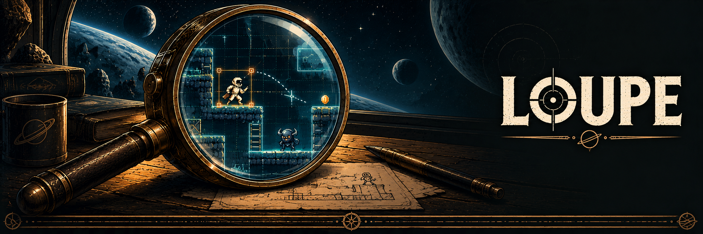
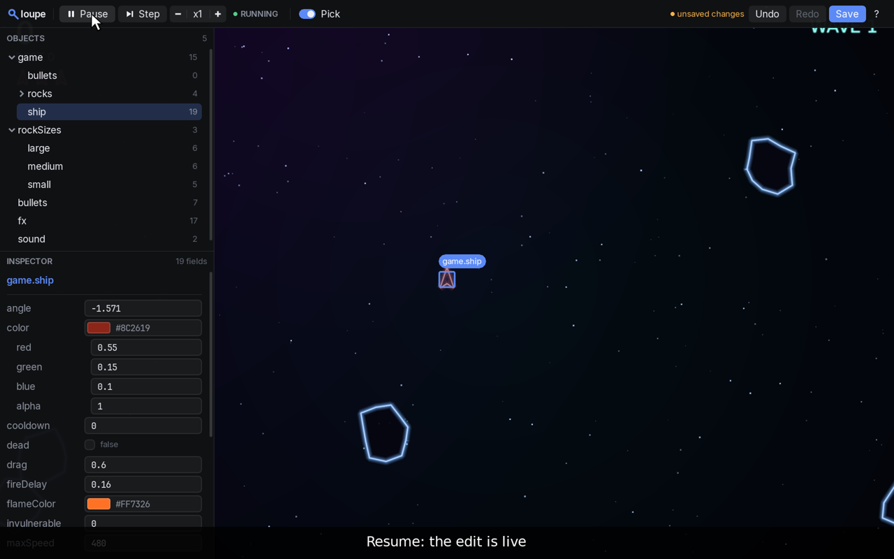

<div align="center">



### Tiny lens. Big “aha!” energy.

**Peek inside your LÖVE game. Poke a value. Keep playing.**

[](https://github.com/ChaosDeSelva/loupe/actions/workflows/ci.yml)
[](LICENSE)
[](https://love2d.org/)

[Get started](#quick-start) · [Website](https://ChaosDeSelva.github.io/loupe/) · [API](docs/api.md) · [AI + MCP](docs/mcp.md) · [Contribute](CONTRIBUTING.md)

</div>



## What is this?

Loupe is a **drop-in live inspector and editor for LÖVE 11.5 games**, written in Lua.
Copy one folder into your game and press **F1** to explore its tables, tweak values,
and move objects while the game runs. No runtime dependencies beyond LÖVE. No game rewrite.

Ever restarted your game twelve times to find the right jump height? This is for that.

## Why “Loupe”?

A loupe is a small magnifying lens used to inspect fine details. That is the idea here:
a close-up view of the objects and values inside a running game. This explains the name’s
fit; the project’s original notes do not record a naming origin story.

## Your new debugging toys

| Want to… | Loupe can… |
| --- | --- |
| Catch that one weird frame | Pause, single-step, and slow down or speed up time |
| Make the jump feel right | Edit numbers, booleans, strings, colors, and nested tables live |
| Find the thing you can see | Pick and drag world objects, including through camera transforms |
| Undo an enthusiastic experiment | Undo/redo edits; one drag is one undo |
| Keep the good tweaks | Save readable overrides and apply them next run |
| Stay in the flow | Hot-reload supported Lua modules while preserving existing state |
| Build your own tools | Use the standalone immediate-mode `loupe.ui` toolkit |

[Watch the 43-second tour](docs/media/loupe-1.1-tour.mp4) · [Read the full API and limitations](docs/api.md)

## Quick start

1. Install [LÖVE 11.5](https://love2d.org/).
2. Copy this repository’s **`loupe/` folder** next to your game’s `main.lua`.
3. Add this at the **end** of `main.lua`, after your `love.*` callbacks:

```lua
local loupe = require("loupe")
loupe.watch(function() return game end, "game")
loupe.attach()
```

Replace `game` with your own state table. The getter keeps working when you replace that
table on restart. Run your game normally and press **F1**.

**First experiment:** open Objects, select a table, change a number, then undo with
Ctrl/Cmd+Z. Ctrl/Cmd+S saves overrides to `loupe_overrides.lua`; your source stays untouched.

## Take it for a spin

```sh
git clone https://github.com/ChaosDeSelva/loupe.git
cd loupe
love examples/asteroids
```

| Example | Try this |
| --- | --- |
| `love examples/asteroids` | Enter to start; arrows/WASD to fly, Space to fire. Press F1 and tweak `game.ship.thrust`. |
| `love examples/platformer` | Enter to start; arrows/WASD to move, Space to jump. Tune `game.player.jump` and `gravity`. |
| `love examples/ui_gallery` | Explore the standalone UI widgets with your mouse. |

On macOS, if `love` is not on your PATH, use
`/Applications/love.app/Contents/MacOS/love` in its place.

**The handy keys:** F1 toggles the inspector, P pauses, `.` steps, `[` / `]` change speed,
and Ctrl/Cmd+Z undoes. Time shortcuts apply while the overlay is open.

[All controls, cameras, and things to tweak →](docs/usage.md)

## Build and check

```sh
./tools/build.sh           # all three demos → dist/*.love
love dist/asteroids.love   # F1 works in the packaged game too
```

On macOS, the builder also creates `.app` bundles when `/Applications/love.app` exists.
These are unsigned local builds. Packaged games save overrides in LÖVE’s save directory;
hot reload requires unpackaged source files.

For development, install LuaJIT, StyLua 2.5.2, and the `busted`, `luacheck`, and `luacov`
LuaRocks packages **for Lua 5.1/LuaJIT**, then run:

```sh
./tools/check.sh
love examples/asteroids --smoke 120
```

The check runs formatting, lint, architecture checks, tests, and coverage gates.
See [CONTRIBUTING.md](CONTRIBUTING.md) for the full workflow and Linux verification.

## A small project with receipts

Loupe was built primarily with AI assistance under human review. The
[process notes](docs/AI.md), [milestone logs](docs/ai-log/), and
[design decisions](docs/decisions/) document that work, including mistakes.

- [API reference](docs/api.md) — integration, persistence, hot reload, and known limits
- [Usage guide](docs/usage.md) — controls, cameras, and examples
- [Manual checks](docs/manual-test.md) — hands-on verification
- [Changelog](CHANGELOG.md) — what changed

## License

[MIT](LICENSE). Make something delightful. Bundled fonts retain their
[Open Font License notices](loupe/fonts/OFL.txt).

## Build with AI. Tune with your hands.

Describe a game to your coding assistant, let it create the source through the
optional [local MCP server](docs/mcp.md), then press **F1** and make it feel right
in Loupe. The assistant and the inspector share live edits and undo history.
Fifteen tools, Python 3.10+ standard library, no hosted relay or API key required
by Loupe. Your AI client may have its own account requirements.

### 1. Connect your assistant

Install LÖVE 11.5 and Python 3.10+, download this repository, and create an empty
folder for your game. In your MCP client, register a **stdio** server with
`python3` as the command and these arguments (replace the absolute paths):

```json
[
  "/absolute/path/loupe/mcp/server.py",
  "--project", "/absolute/path/my-game",
  "--love", "/absolute/path/to/love"
]
```

Use this as your client's argument array, with the server script first. See the
[configuration example and bridge setup](docs/mcp.md#connect) for the complete format.
You can scaffold and edit source before connecting a running game's bridge.

### 2. Ask it to build a game

Give your assistant this prompt:

> Use Loupe MCP's game_capabilities, then game_scaffold with template "afterimage"
> in this empty project. Make it my own small space shooter: keep paired laser
> upgrades, animated thrusters, red enemy shots, and the illustrated/vector toggle.
> Read the source before editing. Keep gameplay values in watched tables. Build
> game.love, and report the generated conf.lua identity so I can configure the
> live bridge. Keep everything local.

Choose `"minimal"` instead for a small blank starting point. The Afterimage
starter includes the complete game source, art, music, tests and browser exporter.
The assistant can use `project_read` / `project_write` for source edits and
`project_assets` to inspect images, audio and fonts. To import your own files,
configure an optional `--asset-inbox /absolute/path/approved-assets`, then use
`asset_import`. Generated art comes from your chosen external image tool;
record its provenance in `ASSETS.md`.

### 3. Launch, inspect, and take over

Every scaffold gets a unique `t.identity` in `conf.lua`. Add `--bridge-dir` to
point at that identity's LÖVE save directory plus `/loupe-mcp`, then reconnect
your MCP client. [Find the bridge directory](docs/mcp.md#connect).
Ask the assistant to run `game_launch`, then `loupe_status` to verify the connection.
It can inspect, edit, undo and capture the native game window.

> Inspect game.player.speed, increase it by 15%, and capture a screenshot.
> Let me try it before saving. Undo the change if I dislike it.

Now press **F1** in the game. Browse **game → player**, change **speed** or
**damage**, pause and step the simulation, then resume and play. Use **Undo** to
compare. **Save** writes local overrides to `loupe_overrides.lua`; it does not
rewrite the game source. Ask the assistant to apply your final values to source
when you want them to become the game's shipped defaults.

### 4. Test and export

Run the included simulation and asset checks, play-test the result, and ask for
`game_build` to create `dist/game.love`. Source and asset changes need a restart;
existing watched scalar values can change live. The Afterimage template also
includes a [browser export workflow](examples/afterimage/README.md).

**Platform boundary:** live MCP runs with native LÖVE. The browser showcase has
Loupe's F1 inspector but does not expose an MCP bridge. Building does not publish
anything to GitHub or itch.io. LÖVE provides rendering, audio and rigid-body
physics; Loupe adds inspection, authoring tools and optional runtime helpers.

### Play the showcase, then build your own

[Afterimage](examples/afterimage) is included as editable source: a space shooter
with generated and vector art modes, animated sprite sheets, modular ship
attachments, original music, image backgrounds, a three-sector story, and Endless.
Press **V** to compare art styles and **F1** to inspect the running game.
Native **F11** toggles fullscreen; **F10** cycles window sizes. Optional reusable
window controls live in `loupe.window`; reusable sprite playback and swept collision
helpers live in `loupe.sprites` and `loupe.collision`. LÖVE handles rendering, audio, and rigid-body physics;
Loupe supplies the live editing and inspection tools.

[The local MCP server](docs/mcp.md) lets a compatible AI client read/write game
source, build and launch it, inspect live state, make undoable edits, and capture
screenshots. It is opt-in and runs locally. The human can then continue editing
in the same Loupe session.

To build the GitHub Pages embed and downloads from the example source, install
`love.js@11.4.1` and run `python3 tools/build_showcase.py --builder path/to/love.js`.
Generated `site/play` and `site/downloads` files are ignored by Git; the Pages
workflow rebuilds them. Asset provenance and exact generation prompts are in
[ASSETS.md](examples/afterimage/ASSETS.md).
